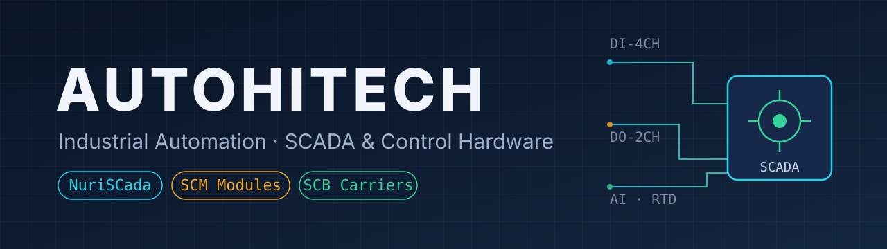

**현장 자동화 시스템과 제어 하드웨어를 만드는 조직입니다.**
소프트웨어(SCADA)와 하드웨어(신호 모듈·캐리어 보드)를 한 곳에서 설계·검증합니다.

## 제품 라인

### 🖥️ 소프트웨어 — SCADA
| 저장소 | 내용 | 공개 |
|---|---|---|
| [`nuriscada`](https://github.com/autohitech/nuriscada) | 무료 오픈소스 크로스플랫폼 SCADA — Rust, Apache-2.0 (설계 단계) | ✅ public |
| `autobase-rea` | 현행 SCADA 베이스 | private |
| `AHT-SCADA-X` | 현행 SCADA | private |

### 🔌 하드웨어 — SCM 신호 모듈 + SCB 캐리어
캐리어 보드(`SCB-STANDARD-A/B`)에 SCM 모듈이 꽂히는 구조입니다
(캐리어 회로도의 `SCM_4` 슬롯·모듈 입출력 매핑으로 확인).
| 모듈 | 기능 | 저장소 |
|---|---|---|
| RTD | 백금측온체 계측 (LM358+트리머) | `SCM-RTD` → [`boards/` 분리 완료](https://github.com/autohitech/SCM-RTD) |
| AI / AO / DO | DIOAIO 통합 설계 | `SCM-AI`·`SCM-AO`·`SCM-DO` (아카이브, 정본 `SCM-DI`) |
| DI | 디지털 입력, 광절연 (TLP290) | `SCM-DI` |
| PWR | 전원 | `SCM-PWR` |
| MIX | 릴레이+광절연 혼합 | `SCM-RTD/boards/SCM-MIX` |

| 캐리어 | 용도 | 저장소 |
|---|---|---|
| `SCB-STANDARD-A/B` | SCM 모듈 탑재 표준 캐리어 | 각 repo (ERC/DRC 검증済) |
| `SCB-008A` | 다기능 (ESP/OLED/전원) | repo (3D·회로도 포함) |
| `SCB-AIW` | 올인원 (ESP/RS485) | repo (3D·회로도 포함) |
| `SCB-4KEY-BUTTONS` | 4키 입력 | repo (3D·회로도 포함) |
| `SCB-ES01/ES12` | ESP8266 브레이크아웃 | 각 repo (3D·회로도 포함) |

### 🧰 라이브러리 · 툴
| 저장소 | 내용 | 공개 |
|---|---|---|
| [`AutohitechLib`](https://github.com/autohitech/AutohitechLib) | 공용 KiCad 풋프린트 89종 — 전 보드 서브모듈로 pin | ✅ public |
| `modbus-source-code`, `modbus-debug-tool` | Modbus 소스·디버그 툴 | private |

## 저장소 지도 (400+)

| 구분 | 저장소 | 비고 |
|---|---|---|
| 쇼케이스 (public) | [`nuriscada`](https://github.com/autohitech/nuriscada) | 무료 오픈소스 크로스플랫폼 SCADA |
| 공용 라이브러리 (public) | [`AutohitechLib`](https://github.com/autohitech/AutohitechLib) | 풋프린트 89종 |
| 현행 제품 | `autobase-rea`, `AHT-SCADA-X`, `autohitech-web`, `autohitech-legacy`, `autohitech-drive`, `atech.biz`, `atech-drive` | 웹·드라이브·현행 SCADA |
| 하드웨어 | `SCB-*` 7종, `SCM-*` 6종 | 위 제품 라인 참조 (전부 README+ERC/DRC+3D 보유) |
| 공통 | `modbus-source-code`, `modbus-debug-tool`, `docker-hsqldb`, `legacy`, `business-card`, `certifications` | 프로토콜·인프라·문서 |
| 아카이브 | `SCM-AI/AO/DO`, `AHT-SCADA-*` 385개 + 원형 3개 | 현장 프로젝트 보존 (읽기 전용) |

## 품질 기준 (하드웨어)

- KiCad 10 CLI로 전 보드 ERC/DRC 실측, 결과는 각 README에 기록
- 공용 풋프린트는 `AutohitechLib` 서브모듈로 버전 고정 (보드별 변형은 `이름__범위`로 분리 보관)
- 3D 렌더 + 회로도 SVG를 각 repo `docs/`에 포함

## 규칙

- 신규 repo: `제품명-연도` 형식만. `AHT-SCADA-N` 번호 증식 금지.
- `main` 직접 푸시 금지, PR 필수 (현행 repo부터).
